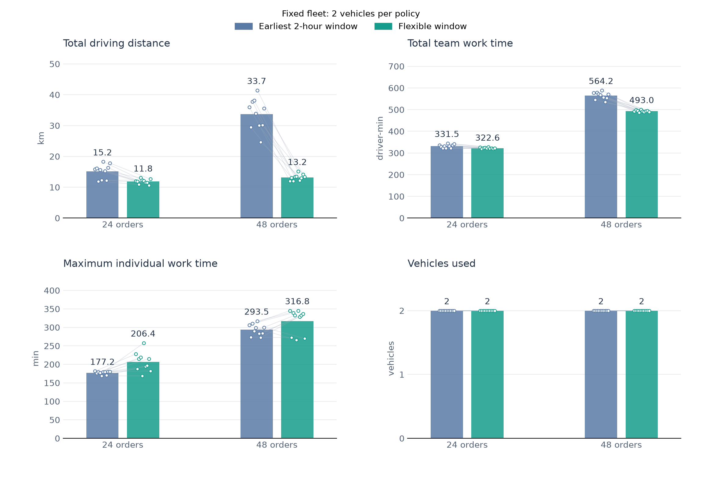
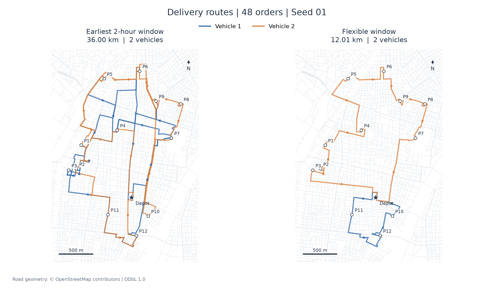

# Delivery-window choice study

A developing research prototype for customer delivery-window choice, sequential route planning, and environmental information in checkout. The repository includes a Japanese participant flow, a route-planning engine, and computational experiments on an OpenStreetMap network in Taito-ku, Tokyo.

## Latest completed mini-study

**Fixed two-vehicle pilot: 24 and 48 synthetic orders** · 2026-11-01

The earliest-feasible two-hour window and flexible-window policies were compared on the same order streams, with exactly two active vehicles under both policies. Ten matched streams were tested at each demand level.



| Mean outcome | 24 orders: earliest → flexible | 48 orders: earliest → flexible |
|---|---:|---:|
| Driving distance | 15.17 → 11.84 km | 33.71 → 13.18 km |
| Team work time | 331.47 → 322.62 driver-min | 564.19 → 492.99 driver-min |
| Maximum individual work time | 177.23 → 206.41 min | 293.54 → 316.78 min |
| Active vehicles | 2 → 2 | 2 → 2 |

**Finding:** the flexible-window policy reduced mean driving and total team work time under the current heuristic, but increased mean maximum individual work time. Improving system efficiency does not automatically balance driver workload. These are synthetic-order computational results, not real-world operational estimates or evidence of a consumer nudge effect.

[Full English report, route figures, limitations, and reproduction instructions](experiments/fixed-two-24-48/README.md)

### Route examples: same 48-order stream



The route panels use seed 1; the summary figure averages all 10 streams per demand level. Destination markers represent locations, and multiple synthetic orders can share a location.

## Run the mini-study

```sh
node experiments/fixed-two-24-48/run.cjs
node experiments/fixed-two-24-48/validate.cjs
```

The experiment uses an isolated engine snapshot. It does not change the checkout app, production routing behavior, or remote database.

## Existing prototype

The participant flow covers product choice, delivery conditions, delivery-window choice, order confirmation, and a post-choice questionnaire. The routing lab supports sequential booking inspection. Experimental UI conditions include a control, an environmental label, and a label with a default selection; final assignment and participant-study procedures remain separate research work.

From the repository root:

```sh
python3 -m http.server 8000
```

- Participant prototype: `http://localhost:8000/`
- Routing lab: `http://localhost:8000/routing-lab.html`
- Original engine checks: `node --test tests/delivery-engine.test.js`

The current app engine starts with no confirmed orders and compares an earliest feasible two-hour promise with a broader receiving window. Subsequent bookings can reposition flexible commitments. Travel speeds, service times, and emissions factors are modeling assumptions; road and building coordinates do not constitute real customer orders or measured operator activity.

## Project status

- Implemented: prototype screens, route calculation, local booking accumulation, original engine tests, and the fixed-fleet computational pilot.
- Prepared in code: shared-booking server and database migrations. Remote deployment and storage validation are not established by this mini-study.
- Remaining research: operational calibration, workload balancing, final participant-study protocol, and consumer-choice outcome analysis.

## Documentation

- [Current fixed-fleet report](experiments/fixed-two-24-48/README.md)
- [Historical model notes](docs/taito-model.md) — include superseded implementation descriptions
- [Previous README](docs/archive/README-before-fixed-fleet-pilot.md) — retained for implementation history
- [Original delivery-information and post-choice survey requirements](배송정보_및_사후앙케이트_요구사항.md)

Road data: © [OpenStreetMap contributors](https://www.openstreetmap.org/copyright), ODbL 1.0.
