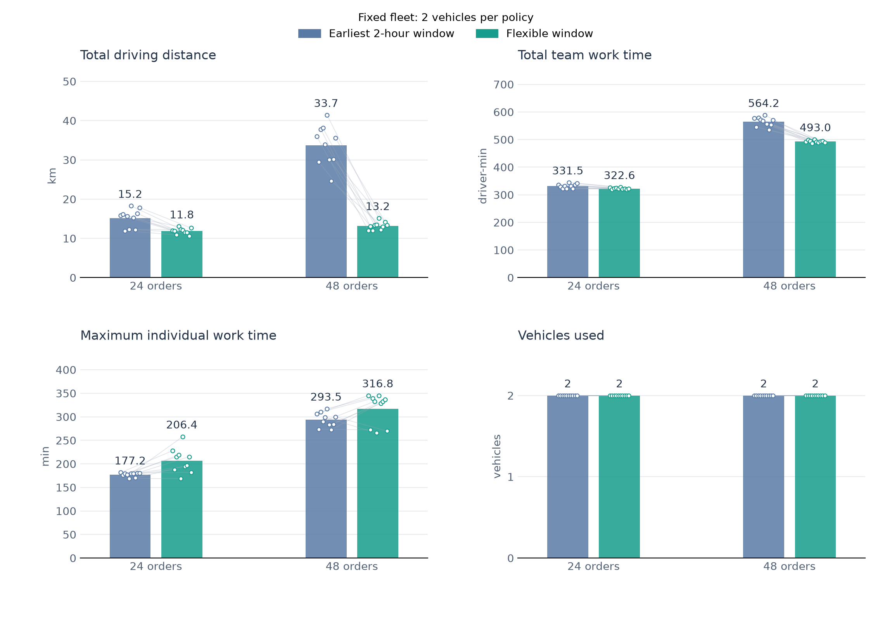
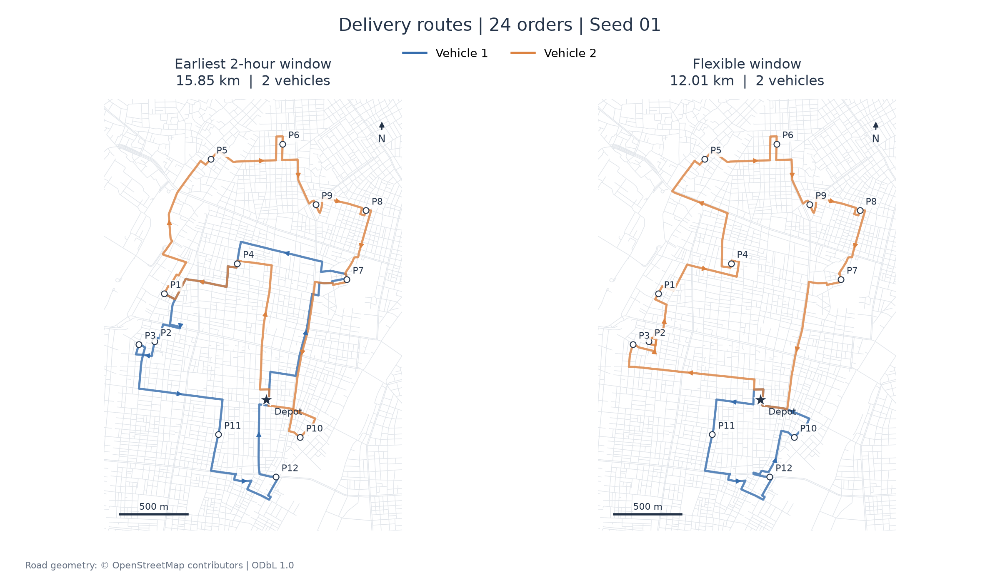
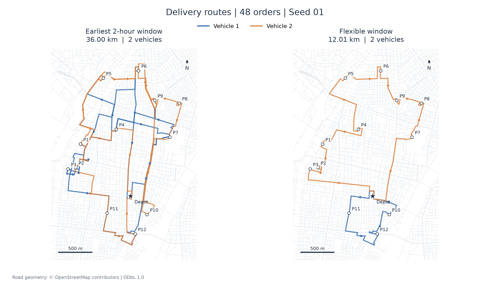
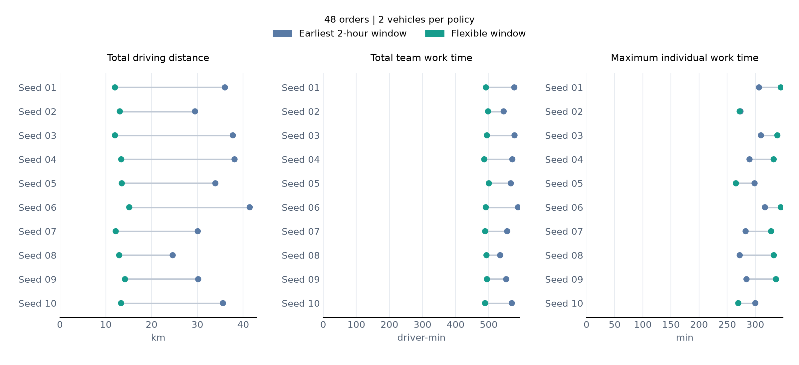

# Fixed-fleet delivery-window pilot

**Version:** `taito-flex-v2.1-fixed-two` · **Recorded:** 2026-11-01

## Research question

How do an earliest-feasible two-hour delivery window and a flexible delivery window compare when both policies use exactly two vehicles for the same 24- or 48-order stream?

## Main finding

Under the current sequential routing heuristic, the flexible-window policy reduced mean driving distance and total team work time at both demand levels. The reduction in total team work time was larger with 48 orders. However, mean maximum individual work time increased at both demand levels. **System efficiency and balanced driver workload are separate objectives.**

These are exploratory computational results from synthetic orders on a real road network. They do not establish real-world savings, consumer uptake, or a causal effect of a nudge.

## Experimental design

| Setting | Specification |
|---|---|
| Demand | 24 and 48 synthetic orders; 10 streams per demand level |
| Seeds | 1–10, fixed deterministic generator |
| Locations | Uniform sampling with replacement from 12 fixed destination candidates on the Taito-ku OSM network |
| Matched comparison | Identical order sequence, parcel, building and receiving conditions under both policies |
| Nested streams | Each 48-order stream extends its matching 24-order stream |
| Fleet | Exactly two nonempty routes after the second accepted booking; both vehicles start at the same depot |
| Assignment constraint | First two accepted bookings activate both vehicles; subsequent insertion and flexible-order relocation preserve two active routes |
| Workload allocation | Equal orders or equal work time per vehicle is not imposed |
| Parcel | 2 kg and 12 L per order |
| Customer | Apartment, elevator available, direct handover, available all day |
| Vehicle capacity | 100 kg and 450 L per vehicle |
| Planning | Next-day, pre-dispatch booking; no en-route dispatch or future-demand forecast |
| Comparison eligibility | Both policies must accept the complete identical demand; all 20 paired streams qualified |

The earliest policy chooses the first feasible two-hour slot from 10:00–12:00 through 20:00–22:00. The flexible policy uses the earliest feasible start through the customer's receiving limit, here 22:00. Options are recomputed as reservations accumulate.

The engine uses sequential insertion and up to two passes of relocation for flexible orders, with the existing objective `distance_km + 0.02 × active_minutes + 0.001 × work_minutes`. It does not provide a global optimum. This compares two implemented booking-and-routing policies; it does not isolate the effect of time-window width independently of the heuristic. The all-flexible policy is also distinct from the application's recommendation-label rule.

## Results

Values are arithmetic means across 10 matched streams at each demand level. Percent changes below use the ratio of the policy means.

| Metric | 24 orders: earliest | 24 orders: flexible | Change | 48 orders: earliest | 48 orders: flexible | Change |
|---|---:|---:|---:|---:|---:|---:|
| Total driving distance (km) | 15.17 | 11.84 | −21.95% | 33.71 | 13.18 | −60.91% |
| Total active time (driver-min) | 223.80 | 210.93 | −5.75% | 448.77 | 380.02 | −15.32% |
| Total team work time (driver-min) | 331.47 | 322.62 | −2.67% | 564.19 | 492.99 | −12.62% |
| Maximum individual work time (min) | 177.23 | 206.41 | +16.47% | 293.54 | 316.78 | +7.92% |
| Vehicles used | 2 | 2 | Fixed | 2 | 2 | Fixed |

Active time is driving plus modeled access and handover work. Team work time adds waiting and excludes the scheduled break; it sums time across drivers rather than measuring elapsed completion time. Maximum individual work time is the longest driver's work time within each scenario, then averaged across scenarios. It is not the mean work time per driver and is not a measurement of fatigue.



Bars and numeric labels show means; dots and connecting lines show the 10 paired observations. They are not confidence intervals. Distance improved in 9/10 streams with 24 orders and 10/10 with 48 orders; total team work time improved in 7/10 and 10/10, respectively (24 orders: one tie and two increases). Maximum individual work time increased in 9/10 and 7/10.

### Routes: 24 orders



### Routes: 48 orders



Both maps use the predeclared seed 1 and a common spatial extent. P1–P12 identify destination locations, not visit sequence or individual orders; multiple orders may share one location. Lines follow stored road-path geometry; colors identify vehicles, and arrows indicate travel direction. Repeated traversals overlap, so route length cannot be inferred from the visible footprint alone. The summary figure averages all seeds; route distances shown in these panels are for seed 1 only.

### Paired observations: 48 orders



## Interpretation and limits

1. Fixing both policies to two active vehicles removes the earlier fleet-count difference. It does not impose balanced allocations.
2. More flexible commitments can allow the heuristic to consolidate visits and reduce repeated driving. The larger 48-order distance reduction occurs in a small set of repeatedly sampled destinations; it is not an estimate for a real delivery territory.
3. Work concentration remains possible even with the same fleet count. Lower team totals therefore do not imply that every driver works less.
4. Speeds, service times, vehicle characteristics, and objective weights are research assumptions. They have not been calibrated to observed operator records.
5. Modeled fuel-combustion CO₂ is distance multiplied by a fixed factor, 0.232 kg/km. Its percentage change duplicates distance, so it is not presented as independent evidence.
6. The first-two-booking activation rule and finite local search affect the outcome. Different initial assignments or search policies may produce different results.
7. Ten deterministic streams are a small exploratory sample. No inferential significance or population-level effect is claimed.

## Reproduce

From the repository root, with Node.js installed:

```sh
node experiments/fixed-two-24-48/run.cjs
node experiments/fixed-two-24-48/validate.cjs
```

To regenerate the English PNG and SVG figures:

```sh
python3 -m pip install -r experiments/fixed-two-24-48/requirements.txt
python3 experiments/fixed-two-24-48/plot_figures_en.py
```

No API key or participant data is required. The runner uses the existing `data/taito-network.json` and the isolated experiment engine; it does not change the app's production engine. The network checksum is calculated after normalizing trailing whitespace to one newline so it matches the archived local input snapshot.

## Files and validation

- [Runner](run.cjs) and [isolated engine](delivery-engine.js)
- [Full results and route schedules](results.json) · [Scenario summary CSV](results.csv)
- [Validation script](validate.cjs) · [Provenance](provenance.json)
- [Plotting script](plot_figures_en.py)
- Vector figures: [summary](figures/pilot-summary.svg), [24-order routes](figures/pilot-routes-24.svg), [48-order routes](figures/pilot-routes-48.svg), [paired observations](figures/pilot-paired-48.svg)

Checks cover full-demand acceptance, exactly two active routes, order identity and conservation, capacity, time-window and shift feasibility, summary recomputation, network and engine hashes, and stored route-distance consistency.

## Next step

Compare the same policies with an explicit individual-work-time or workload-balance constraint before using a combined environmental-and-driver-benefit claim. A later participant experiment should separately test whether labels or defaults change flexible-window uptake.

## Sources

The experiment derives from the repository's `taito-flex-v2.1-empty` engine at commit `a98209b0d9ca9abc00163dd38e8876112ab2cf41`. The road-network source is Git blob `c8fb2ad5f7d1053fd0162f42fb12216f580009bc`; exact normalized-file and experiment-engine hashes are recorded in provenance.

Road geometry: © [OpenStreetMap contributors](https://www.openstreetmap.org/copyright), ODbL 1.0. See [historical model notes](../../docs/taito-model.md) for source-data preparation and background assumptions; superseded implementation descriptions there are not the specification for this pilot.
